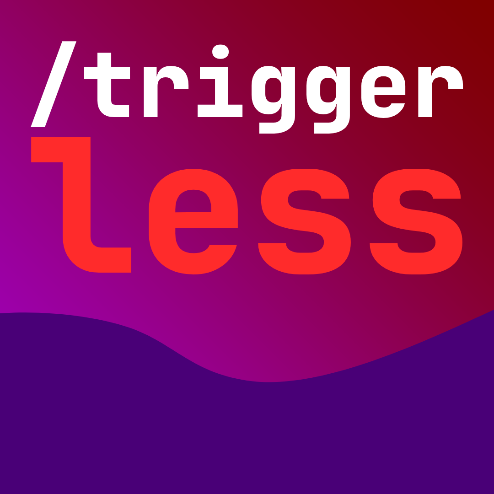

<div align="center">
    
</div>

---

> **Note:** The alias commands will only show as valid on multiplayer. I don't know why or how but that's just how it is! Ignore the errors before pressing enter and it will work.

## Overview

`/trigger` commands are **ugly**. Why not turn them into normal ones? **Triggerless** can do just that! Best of all, this mod is entirely client-side.

**Vanilla**  
```mcfunction
/trigger spawn
```

**Triggerless**
```mcfunction
/spawn
```

And if your trigger command does not work, you can try this command to regenerate the aliases! Rejoining also works.
```mcfunction
/reload-triggers
```

## Contributing

I don't usually make mods, preferring plugins instead. Beware...  
[MIT license!](LICENSE.md)
